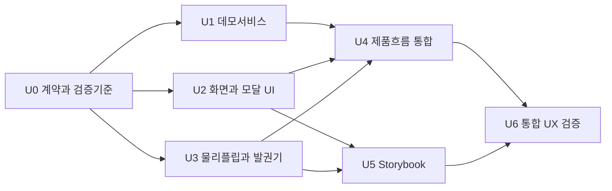

# RFC — 전체 UI 흐름과 Storybook 완성

작성일: 2026-10-10 · 상태: 주요 데모 런타임·프리뷰 호환성·최종 자동 검사 통과

## 요청과 범위

사용자 요청은 실제 기계처럼 동작하는 패널, 전체 UI, Storybook 및 반복 UX 개선이다. 기준은 `screen-spec.md`의 최신 사용자 합의이며, 기존 고정 샘플 프리뷰에서 입력·결과·복원·재발급을 연결한 **완전한 데모 UI 흐름**으로 확장한다.

- 독립 화면 5개: 입장 → 이메일 참가 확인 → 닉네임·성 입력 → 추첨 전광판/발권기 → 탑승권.
- 입장: GDG HOME COMING, 행사 정보, 주요 **발권하기** 버튼 하나, 하단 문의하기 카카오톡 링크. 상단 GDG AIR·소리 토글·신청 마감 표시 없음.
- 이메일: 승인된 제목·설명·확인하기, 신규/기존 분기, 형식 오류·명단 없음·연결 오류 및 재시도. 기존 데모 티켓은 자동 복원한다.
- 이름: “닉네임을 입력해주세요.” / “(닉네임 + 성 조합)” / “JASON JEONG” / “발권하기”. 법적 실명 요구·대문자 강제·임의 영문 제한을 추가하지 않는다.
- 결과 공개: 중앙 힌지를 가진 실제 상하 반부 회전, 순서 있는 A→Z 물리 플립 및 목표 글자 정착. 무작위 스크램블·전체 글자의 페이드 교체로 대체하지 않는다. 최신 물리 휠 요청은 이전 단일 목표 글자 회전 설명보다 우선한다. 숫자 휠은 0→9, 휠 없는 문자 처리와 긴 입력 타이밍은 구현 기본안으로 명시한다.
- 공개는 6~8초 목표, 국가 정착·정보 패널 등장 이후 **확인했어요**를 기다린다. 자동 출력·자동 전환은 하지 않는다.
- 확인 후 4번 내부의 상단 발권기에서 즉시 가로형 티켓을 위에서 아래로 출력한다. 세로 핸드폰이 기본이며 가로 회전 요구·안내·orientation 구독·rotate 상태는 삭제한다. printing → complete는 1600ms 단일 출력이며 방향 변경으로 재출력·타이머 초기화·결과 변경 금지. 티켓은 세로에서 유지한다.
- 탑승권: 전체 티켓 감상·확대 모달·고해상도 이미지 저장·소개와 키워드 3개·본인 포함 동행 인원·재발급 확인 및 소진 상태.
- 공통: max-width 500px, 모바일 세로·가로, 넓은 화면 중앙 정렬, 기본 무음, reduced-motion, 입력·로딩·빈값·실패·재시도·결과 확인 필요 상태, 접근성.
- 실제 정책: 20개국/국가별4명과 행사60명은 별개, 이메일별 재발급1회/직전국가 제외/기존 자리 반환·새 자리 확보·횟수 차감 원자 처리. 데모에서 모델 검증하되 서버 보장을 주장하지 않는다.

## 데모와 실제 서비스 경계

Sheets 정보는 제공되지 않았고 Firebase는 초기 설정만 있다. 로컬 데모 서비스는 지정된 테스트 참가자/오류 시나리오와 브라우저 저장으로 UI를 검증한다. 제품 화면에는 짧고 정확한 데모 고지를 제공하며 개발용 시나리오 조작부는 Storybook에서 제공하는 구성을 기본안으로 한다.

**데모 참가 확인 기본안:** 예약된 예시 도메인의 `demo@gdg.example` 같은 고정 테스트 이메일을 allowlist로 사용하고 사용할 데모 이메일을 화면에 안내한다. 형식에 맞는 모든 이메일을 실제 신청자로 인정하지 않는다. 미등록 값은 승인된 명단 없음 UX, 연결 실패·timeout·인원 실패는 Storybook 주입 시나리오로 재현한다. 별도 가입·실명확인·소유권 인증은 추가하지 않는다. 이 allowlist는 행사 Google Sheets와 관계없는 테스트 자료이며 구체적인 fixture 값은 서비스 담당이 정한다.

- 데모 티켓·집계는 해당 브라우저의 테스트 자료이며 실제 참가·실배정·실시간 동행 정보가 아니다. 명단 전체와 타인 티켓을 UI에 노출하지 않는다.
- 실제 API가 없는 조건: Sheets URL/탭/열/접근, 서버 명단 확인, 신뢰할 수 있는 세션 권한, 서버 배정·재발급 트랜잭션·멱등성, 동시 기기 복원·집계, 운영 종료·삭제 정책. 빈 조건을 로컬 성공으로 은폐하지 않는다.
- 서비스 계약은 로딩/명단 없음/확정 실패/결과 확인 필요/저장 결과 복원 등을 분리한다. timeout은 무조건 재배정하지 않고 결과 확인을 먼저 한다.
- QR 이스터에그·임의 신규 신청 링크·관리자 화면·운영 마감/명단 삭제 정책·실명 인증·배포는 이번 범위 밖이다. QR은 확보 영역만 표현하며 가짜 코드나 임의 목적지로 연결하지 않는다.
- 저장 형식·다운로드 방식, 소리 조작 위치·지속 범위, 소개 초안, 이름 처리 규칙은 승인된 것과 구현 기본안을 구분해 기록한다. 다운로드 요청 성공을 사진첩 저장 완료로 단정하지 않는다.

## 의존 그래프

## 작업 단위

모든 unit은 **research → implementation plan → implementation → tests → review → merge-ready report** 순서로 수행한다. 보고에는 변경 파일·검증 결과·남은 위험·rollback 방법을 포함한다.

### U0 — 계약과 실행기준

- `depends_on`: 없음
- `scope`: 최신 합의 정리, 데모 경계, 컴포넌트/상태 인터페이스 조율, 파일 소유권 확정.
- `acceptance_tests`: 5화면·확인 대기·세로 즉시 출력·모달/오류/복원 기준이 누락 없이 연결되고, 미정 정책을 확정으로 승격하지 않는다. 담당별 변경 파일 충돌을 확인한다.
- `risk_level`: Tier 1 / 낮음
- `rollback_plan`: 이 RFC/실행 로그의 해당 단위 설명만 수정한다. 원본/vault와 다른 담당의 작업은 유지한다.

### U1 — 데모 서비스와 결과 모델

- `depends_on`: U0
- `scope`: 프론트가 소비할 데모 명단 확인/발급/복원/재발급/집계 계약, 20개국 자료, 로컬 보존과 오류 시나리오. 실제 Sheets/Firebase API 연결은 하지 않는다.
- `acceptance_tests`: 신규/기존/명단 없음/연결 실패를 재현한다. 중복 제출·재시도는 기존 결과를 유지한다. 1회 재발급·직전 국가 제외·게이트 유지·실패와 대안 없음 시 기회 유지, 로컬4명 상한/자리 반환 모델을 검증한다. timeout→결과 조회와 최신 상태 복원을 검증한다. 브라우저 로컬 모델의 서버 동시성 한계를 기록한다.
- `risk_level`: Tier 2 / 중간
- `rollback_plan`: 데모 어댑터의 변경 파일만 이전 상태로 되돌리고 의존 U4는 통합 대기로 돌린다. 사용자 데이터 일괄 삭제는 하지 않는다.

### U2 — 전체 화면·티켓·모달 표현

- `depends_on`: U0
- `scope`: 디자이너가 입장/이메일/이름/탑승권 및 확대·재발급 모달을 props 기반 표현 컴포넌트로 구현. UI 스타일·시각 모션 담당.
- `acceptance_tests`: 승인된 CTA·문구·행사정보 일치, 상단 제거 항목 없음, 하단 접근 가능한 문의 링크, 오류별 표현, 긴 표시명 누락 없음, 티켓 정보/3키워드/인원/재발급 상태, 모달 닫기·초점 복귀. 저장 대상은 티켓만이며 이메일·버튼·힌트 제외. 320/390/500px와 가로에서 500px 상한 및 스크롤 확인.
- `risk_level`: Tier 2 / 중간
- `rollback_plan`: 해당 표현 컴포넌트/스타일만 되돌리고 U4/U5에서 준비 전 상태로 처리한다. 기존 플립 컴포넌트를 임의 변경하지 않는다.

### U3 — A→Z 물리 플립과 발권기

- `depends_on`: U0
- `scope`: 실제 힌지 중심 상하 반부 회전·연속 휠·정착·정보 stagger 및 발권기 출력. 비즈니스 상태는 프론트에서 전달하고 모션 완료 이벤트가 업무 성공을 결정하지 않는다.
- `acceptance_tests`: A→Z 순서/목표 글자 정착/연속 반부 연결/중앙 힌지/양면 방향을 확인한다. 랜덤 스크램블 없음. 6~8초 공개 목표와 긴 입력 처리의 차이를 기록한다. 확인 전 출력 없음, 세로 확인 즉시 상단→하단1회출력/방향 변경 중 타이머 유지. reduced-motion은 확인을 유지하고 즉시 결과를 보여준다. 기본 무음, 접근 가능한 확정 결과 알림, 타이머 정리 검증.
- `risk_level`: Tier 2 / 높음
- `rollback_plan`: 플립/발권기 표현과 관련 휠 계획만 되돌리고 이전 안정 프리뷰를 보존한다. 실패 unit 위에 U4를 통합하지 않는다.

### U4 — 라우팅·입력·상태·저장 통합

- `depends_on`: U1, U2, U3
- `scope`: 프론트가 제품 5화면과 발권기 하위 상태를 연결한다. 접근 분기·입력 검증·복원·재발급·이미지 생성/다운로드·브라우저 실패를 통합한다.
- `acceptance_tests`: 입장→이메일→닉네임→저장된 데모 결과→전광판→확인→세로 즉시 출력→티켓 경로를 검증한다. 기존 티켓 복원은 신규 추첨을 건너뛴다. 직접 URL/뒤로가기/새로고침/중복클릭/응답 지연을 검증한다. 확대·취소·재발급 성공/실패·기회소진·저장 성공/실패·인원만 재시도까지 연결한다. 저장 이미지와 입력 이름의 일치/클리핑을 확인한다.
- `risk_level`: Tier 2 / 높음
- `rollback_plan`: 라우팅/컨트롤러 변경만 되돌려 기존 프리뷰 경로를 유지한다. 데모 저장 형식 변경은 버전/호환 처리로 제한하고 임의 일괄 cleanup은 하지 않는다.

### U5 — Storybook과 상태 카탈로그

- `depends_on`: U2, U3
- `scope`: Storybook 설정/스크립트·5화면·발권기·모달·공통 상태 stories와 interaction 검증. 제품 라우팅을 대체하지 않는다.
- `acceptance_tests`: Storybook 실행/정적 빌드. 각 화면 기본·로딩·오류·긴 값·복원·재발급 소진/대안 없음·저장 실패·reduced-motion·세로/가로를 재현한다. stories만 import해도 실제 Firebase/Sheets를 호출하지 않는다. 주요 CTA와 모달 상호작용 검증.
- `risk_level`: Tier 2 / 중간
- `rollback_plan`: Storybook 관련 설정·stories·명령만 되돌린다. package.json/lockfile은 지정 소유자만 수정하고 다른 의존성 변경을 유지한다.

### U6 — 통합 검증과 반복 개선

- `depends_on`: U4, U5
- `scope`: 프로젝트 검사·상태 테스트·브라우저 UI/모션·접근성·저장 이미지·slop 검토. 실패를 담당 unit으로 돌려 재검증한다.
- `acceptance_tests`: 프로젝트 check/build, Storybook build와 의미 있는 상태/interaction tests. Aside로 실제 320/390/500px 세로, 667×375/844×390 가로, 넓은 화면 중앙 500px을 검증한다. 키보드/모달 초점/텍스트 확대/reduced-motion/타이머 종료/이미지 파일을 확인한다. UI 업데이트마다 scanner 재실행·수동 triage·변경 화면 확인. 자동 검사와 물리 기기 확인은 별도 증거로 보고한다.
- `risk_level`: Tier 2 / 높음
- `rollback_plan`: 실패 영역의 unit을 통합 큐에서 제외하고 증거를 남겨 범위를 좁힌다. 마지막 통과 상태를 보존하며 Git branch/worktree 삭제·자동 push·배포는 하지 않는다.

## 소유권과 통합 큐

초기 intake 당시 `main`의 공유 작업 폴더였고 소스·문서·설정은 untracked였다. 이는 당시 스냅샷이며 현재 Git 상태를 재확인한 진술이 아니다. unit별 branch/rebase 수행 보고는 없다. 기존 변경을 강제 reset/clean으로 제거하지 않는다.

| 역할             | 파일 소유권 기본안                                                       |
| ---------------- | ------------------------------------------------------------------------ |
| 기획자           | 이 RFC와 `ui-execution-log.md`만 작성                                    |
| 데모/백엔드 역할 | 새 서비스·데이터·계약·서비스 tests; 실제 서버 연결 없음                  |
| 디자이너         | 표현 컴포넌트·관련 CSS·UI tokens, 기존 DepartureReveal/TicketIssuer 표현 |
| 프론트           | App/라우트·업무 hooks·입력/저장 integration tests                        |
| Storybook 담당   | .storybook·stories·Storybook 전용 tests                                  |
| 지정 설정 소유자 | package.json/bun.lock/config를 직렬 수정                                 |
| 부모 매니저      | 소유권 최종 배정·충돌 조율·검증/통합 큐 관리                             |

위 배정은 충돌 방지 기본안이며 실제 할당은 부모가 확정한다. 휠 계획/hooks 공유 변경도 한 명을 소유자로 지정한다. 별도 담당은 의존 인터페이스를 합의한 후 소유 파일 밖 수정 요청을 매니저에게 전달한다.

첫 3화면의 props 계약 기본안: Landing은 `onStart`, Email/Nickname은 `value, onChange, onSubmit, onBack, status, error`. 표시와 입력 이벤트 전달은 디자이너, 검증·서비스·라우팅은 프론트 담당이다. fixture·오류 상태는 Storybook 담당이 props로 공급한다. Storybook 담당은 제품 hooks/화면을 임의 수정하지 않고 접근성/검증 피드백을 소유자에게 전달한다.

통합 큐: U0 → (U1/U2/U3 독립 검증) → U4 → U5 최종 연결 → U6. U5는 U2/U3 준비 이후 병렬 시작 가능하다. 실패 의존 unit은 통합 금지. 공유 파일 통합마다 영향 범위 테스트를 재실행한다. 후속 source branch 사용 시 latest integration branch로 rebase한 뒤 각 merge 이후 integration tests를 재실행한다.

## 100점 평가 기준

현재 상태는 `ui-execution-log.md`의 최신 통합 증거 갱신을 따른다. 제품 입력 오류·모달 초점 복귀·PNG·재발급/복원 및 Storybook 대표 viewport 증거가 확보됐다. 두 원인의 /departure→/ticket 회귀를 수정하고 동일 AppFlow 21 steps Pass와 실제5173 신규 확인 대기를 확인했다. 실제 App iframe 반복회전 중 단일 출력·타이머 유지·완료 티켓 연결과 기존 preview URL gate/replay를 확인했다. 부모 최종 check/build/37stories build도 exit0다. 아래 미검증 항목이 남아 전체 점수 계산을 보류한다. 예비 100점 또는 “100점짜리 UX 완료”를 선언하지 않는다.

100점은 아래 **검증 항목 전부 통과**의 목표다. 미검증은 점수를 부여하지 않으며 주관적 완벽 선언을 하지 않는다. 각 항목은 전부 통과 시 해당 배점, 실패/미검증은 미부여로 기록한다. 총점을 발표할 때 반드시 잔여 미검증과 실제 API/기기 경계를 함께 적는다.

| 항목                                         | 배점 | 필수 근거                                  |
| -------------------------------------------- | ---: | ------------------------------------------ |
| 승인된 5화면 정상 흐름·기존 결과 복원        |   10 | 통합 interaction + 실제 브라우저 경로      |
| 오류/재시도/중복/재발급·결과보존             |   10 | 서비스/상태 tests + UI 시나리오            |
| 티켓 확대·저장·인원·콘텐츠                   |   10 | 모달 검증·저장 이미지 실물·실패 경로       |
| A→Z 물리 플립·목표 정착·힌지                 |   10 | 휠 tests + 느린 모션 시각 확인             |
| 확인 대기·세로 출력·단일 출력·reduced-motion |   10 | 상태 tests + 세로 출력/모션 시각 확인      |
| 320/390/500px·짧은 가로·넓은 화면500px       |   10 | 화면별 viewport 증거                       |
| 긴 이름·키보드·텍스트 확대·safe-area         |   10 | 긴 값/확대 시각 확인 + 실제 기기 한계 기록 |
| 라벨·오류·키보드·모달 초점·결과 알림·대비    |   15 | 접근성 검사 + 키보드 수동 확인             |
| Storybook 상태 카탈로그·build·interaction    |    5 | Storybook 빌드·주요 stories 동작           |
| slop triage·카피·정보정확성·데모 경계        |   10 | 매 UI scan/report·화면 확인·정책 대조      |
| 합계                                         |  100 | 점수별 증거 없는 자기평가 금지             |

### 최신 증거와 배점별 남은 조건 — 통합 완료 판정 전

일부 증거와 rubric 전체 통과를 구분한다. 각 배점은 모든 조건 통과 후 부여하며 현재 총점은 보류한다. 부모의 실제 5173 QA, `storybook-quality.md`의 6006 CSS viewport/interaction 및 독립 readback을 반영했다. 문서 담당은 브라우저를 재조작하지 않았다.

| 배점 항목 | 현재 근거 | 남은 조건 / 상태 |
| --- | --- | --- |
| 정상 흐름·복원10 | AppFlow21stepsPass·부모신규7초대기·실제App rotate→printing→complete→ticket 결과일치·ATH/DEL복원·preview gate/replay | 주요 정상범위 runtime·최종 전역검사 통과 |
| 오류·재시도·재발급10 | 제품 입력오류/취소·FCO→ATH/A03/소진·참가자변경·서비스 실패보존tests | 실패/대안없음·중복/timeout 최종 제품 integration 경로 미검증 |
| 티켓·확대·저장·인원10 | 실제PNG JASON/DEL/A03 직접확인·확대Escape초점복귀·readablemode/긴값story | 저장실패·집계 재시도 제품경로·긴이름PNG 미검증 |
| 물리플립10 | wheel-review 순서·힌지·정착시각·wheeltests·실제App 약7초확인대기 | 긴입력별 전체시간/6~8초 차이 최종 대조 미검증 |
| 확인·방향·reduced-motion10 | 상태tests·reducedstory·실제App 세로0장/반복회전동일1장/1712ms완료/2113ms동일1장·완료CTA 결과일치 | 일반모션 CSS runtime 통과, OS설정의 전체App reduced-flow 별도검증 필요 |
| viewport10 | 대표320/390/500·667×375/844×390·500px상한·overflow readback | 모든 제품화면/오류를 모든폭에서 검증한 증거 아님 |
| 긴이름·확대·기기10 | 긴이름wrap·CSSroot200%reflow·확대pan/scroll | 브라우저zoom/OS글자설정·실제폰키보드·safe-area 미검증 |
| 접근성15 | 대표axe·수동대비·제품확대/취소trigger복귀·제목focus코드수정 | 전체 제품keyboard/제목실제focus/스크린리더 결과알림/오류상태 대조 미검증 |
| Storybook5 | 37stories·대표play·AppFlow21stepsPass·실제App수동회전·viewport/a11y·최종build | 최종check/build/Storybookbuild exit0. 모든story 개별axe/viewport 통과 주장은 아님 |
| 카피·slop·경계10 | 최종src39파일3그룹14hit intentional/confirmed없음·승인CTA/문의URL/제거사항·demo고지 source대조 | 해당검토 근거확보. 전체시각품질의100점 의미로 확대하지 않음 |

실제 Sheets/Firebase 운영 연결, 서버 동시성·멱등 트랜잭션, 배포와 물리 기기 검증은 확보 증거에 포함되지 않는다. 다운로드 파일 확인은 사진첩 저장 완료와 별개다.

## 최신 세로 출력 정책 적용

2026-10-10 사용자 수정은 위 수용기준에 반영했다. 아래와 앞선 검증 표의 rotate·세로0장·반복회전 증거는 변경 전 구현의 역사적 증거이며 최신 출력 UX 통과를 뜻하지 않는다. 현재 흐름은 확인 gate, 단일 1600ms 종료, 중복확인·오래된 run 타이머 방어, reduced-motion을 유지하고 orientation 구독을 제거한다. 최신 세로 출력의 시각 증거는 별도로 기록한다.

## 통합 위험

1. 실제 참가자 데이터가 없는 데모의 성공을 운영 완료로 오해할 위험: 제품·보고·stories에서 데이터 경계를 명시한다.
2. A→Z 전체 순환과 긴 승객명은 6~8초를 넘길 수 있다: 계산된 휠 일정과 화면 확인으로 조율하고, 글자 누락으로 시간을 맞추지 않는다.
3. 모바일 주소창/키보드의 viewport 방향·높이 변화: 출력은 방향과 독립이며 완료된 티켓을 지우거나 출력 상태를 재시작하지 않는다.
4. 공유 hooks/props/CSS와 설정 충돌: 단일 소유권·통합 큐·영향 테스트로 관리한다.
5. 로컬 저장·이미지 생성은 브라우저별 제한: 실패 시 티켓 보존·재시도, 다운로드와 사진첩 저장 구분. 물리 기기 미검증을 숨기지 않는다.
6. 이전 가로 회전 조건과 rotate 검증은 역사적 기록이다. 최신 정책은 공개6~8초·확인 대기·세로 즉시 상단→하단 출력이며 이전 조건을 대체한다.
